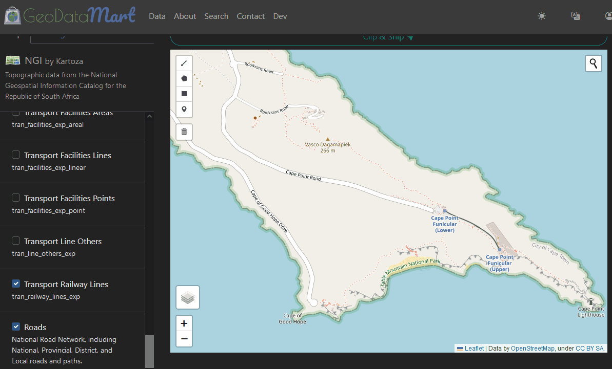

# Geodata Mart

Search, select, clip, and deliver spatial data sources.

[https://data.kartoza.com](http://data.kartoza.com)



## Table of Contents

- [Prerequisites](#prerequisites)
- [Quick Start Guide](#quick-start-guide)
- [Service Access URLs](#service-access-urls)
- [Development Workflow](#development-workflow)
- [Docker Services Explained](#docker-services-explained)
- [Common Issues & Troubleshooting](#common-issues--troubleshooting)
- [Verification Steps](#verification-steps)
- [Additional Development Commands](#additional-development-commands)
- [Deployment](#deployment)
- [Framework & Settings](#framework--settings)

## Prerequisites

Before you begin, ensure you have the following installed on your development machine:

### Required Software

- **Docker** (version 20.10 or higher)
  - [Install Docker](https://docs.docker.com/get-docker/)
- **Docker Compose** (version 2.0 or higher)
  - [Install Docker Compose](https://docs.docker.com/compose/install/)
- **Git**
  - For version control and cloning the repository

### Optional (for local development tools)

- **Python 3.11+**
  - For running pre-commit hooks and local linting tools
- **Pre-commit**
  - For code quality checks before committing
  - Install: `pip install pre-commit`

### Operating System Notes

- **Linux**: Recommended for development. May require adding your user to the `docker` group to run Docker without `sudo`.
- **macOS**: Works well with Docker Desktop.
- **Windows**: Requires Docker Desktop with WSL2 backend. **Important**: Add `FORKED_BY_MULTIPROCESSING=1` to your `.env` file to prevent Celery worker failures.

## Quick Start Guide

Follow these steps to get the development environment up and running:

### 1. Clone the Repository

```bash
git clone https://github.com/kartoza/geodata-mart.git
cd geodata-mart
```

### 2. Configure Environment Variables

Copy the example environment file and customize it:

```bash
cp .env.example .env
```

**Important environment variables to review:**
- `DJANGO_SUPERUSER_USERNAME`: Admin username (default: `admin`)
- `DJANGO_SUPERUSER_PASSWORD`: Admin password (default: `admin` - **change for production!**)
- `DJANGO_SUPERUSER_EMAIL`: Admin email
- `DJANGO_SECRET_KEY`: Secret key for Django (auto-generated in example)
- Port configurations: `DJANGO_PORT`, `MINIO_CONSOLE_PORT`, `MAILHOG_PORT`, `FLOWER_PORT`, etc.

### 3. Build and Start Services

Build the Docker images and start all services:

```bash
docker compose up -d --build
```

This will:
- Build the Django application image
- Pull all required service images
- Start all containers in detached mode

**First-time setup may take 5-10 minutes** as Docker downloads images and builds the application.

### 4. Run Database Migrations

Once services are running, apply database migrations:

```bash
docker compose exec django python manage.py migrate
```

### 5. Create Superuser

Create an admin user for accessing the Django admin panel:

```bash
docker compose exec django python manage.py createsuperuser
```

Or use the pre-configured superuser from `.env`:

```bash
docker compose exec django python manage.py shell -c "
from django.contrib.auth import get_user_model;
User = get_user_model();
User.objects.create_superuser('admin', 'admin@dev.localhost', 'admin') if not User.objects.filter(username='admin').exists() else None
"
```

### 6. Load Sample Data (Optional)

If sample projects are enabled in your `.env` (`SAMPLE_PROJECTS=True`), they will be loaded automatically on first run.

### 7. Access the Application

Open your browser and navigate to:
- **Main Application**: [http://localhost:8000](http://localhost:8000)
- **Django Admin**: [http://localhost:8000/admin/](http://localhost:8000/admin/)

## Service Access URLs

Once your development environment is running, you can access various services:

| Service | URL | Description | Credentials |
|---------|-----|-------------|-------------|
| **Django Application** | [http://localhost:8000](http://localhost:8000) | Main application | User accounts you create |
| **Django Admin** | [http://localhost:8000/admin/](http://localhost:8000/admin/) | Django administration panel | `admin` / `admin` (from `.env`) |
| **API Documentation** | [http://localhost:8000/api/schema/swagger-ui/](http://localhost:8000/api/schema/swagger-ui/) | DRF Spectacular API docs | Same as application |
| **MailHog** | [http://localhost:9002](http://localhost:9002) | Email testing interface | No authentication |
| **Flower** | [http://localhost:9003](http://localhost:9003) | Celery task monitoring | Check `.env` for credentials |
| **MinIO Console** | [http://localhost:9001](http://localhost:9001) | S3 storage management | Check `.env` for access keys |
| **Sphinx Docs** | [http://localhost:9004](http://localhost:9004) | Project documentation | No authentication |
| **QGIS Server** | [http://localhost:8080](http://localhost:8080) | QGIS WMS/WFS server | No authentication |

**Note**: Ports may differ if you've customized them in your `.env` file.

## Development Workflow

### Running Django Management Commands

Because Django runs in an isolated container, you need to execute commands inside the container:

```bash
# General pattern
docker compose exec django python manage.py <command>

# Examples
docker compose exec django python manage.py makemigrations
docker compose exec django python manage.py migrate
docker compose exec django python manage.py createsuperuser
docker compose exec django python manage.py shell
docker compose exec django python manage.py collectstatic --noinput
```

### Using the setenv.sh Helper Script

When attaching a shell to the container, run the helper script to configure environment variables:

```bash
docker compose exec django bash
source /app/setenv.sh
python /app/manage.py shell
```

**VS Code Users**: The provided `.vscode/settings.json` automatically runs this script when using the Docker extension's attach command.

### Hot Reloading

The development server supports hot reloading:
- Python code changes are automatically detected
- For frontend changes (CSS/JS), you may need to restart the server or use the `frontend.py` settings

### Running Tests

Execute the test suite:

```bash
# Run all tests
docker compose exec django pytest

# Run specific test file
docker compose exec django pytest geodata_mart/users/tests/test_models.py

# Run with coverage
docker compose exec django coverage run -m pytest
docker compose exec django coverage report
```

### Code Quality Checks

The project uses several tools to maintain code quality:

```bash
# Format code with Black
docker compose exec django black .

# Run flake8 linting
docker compose exec django flake8

# Run type checking with mypy
docker compose exec django mypy geodata_mart

# Run all pre-commit hooks
pre-commit run --all-files
```

### Pre-commit Hooks Setup

For local development with pre-commit hooks:

```bash
# Create a virtual environment
python -m venv venv
source venv/bin/activate  # On Windows: venv\Scripts\activate

# Install development dependencies
python -m pip install -e .[dev]

# Install pre-commit hooks
pre-commit install
```

## Docker Services Explained

The `docker-compose.yml` defines multiple services that work together:

### Core Application Services

- **django**: Main Django application server running on port 8000
  - Serves the web application
  - Handles HTTP requests
  - Runs with development settings by default
  
- **postgres**: PostGIS-enabled PostgreSQL database
  - Stores all application data
  - Includes PostGIS, hstore, topology, raster, and pgrouting extensions
  - Persists data in the `db-data` volume

- **redis**: In-memory data store
  - Used as cache backend
  - Message broker for Celery tasks
  - Persists data between restarts

### Background Task Processing

- **celeryworker**: Celery worker for asynchronous task execution
  - Processes background jobs (data processing, email sending, etc.)
  - Multiple workers can be scaled up for production
  
- **celerybeat**: Celery beat scheduler
  - Schedules periodic tasks
  - Manages cron-like job scheduling

- **flower**: Celery monitoring dashboard (port 9003)
  - Web-based tool for monitoring Celery tasks
  - View task history, status, and worker performance

### Supporting Services

- **qgis**: QGIS Server for map rendering
  - Serves WMS/WFS map services
  - Renders geospatial data
  - Provides OGC-compliant map services

- **minio**: S3-compatible object storage
  - Stores uploaded files (images, documents, geodata)
  - Provides S3 API for file operations
  - Console available at port 9001

- **mailhog**: Email testing tool (port 9002)
  - Catches all outgoing emails in development
  - Provides web interface to view sent emails
  - No emails actually sent to real addresses

- **docs**: Sphinx documentation server (port 9004)
  - Serves project documentation
  - Auto-rebuilds on file changes

- **dbbackups**: Automated database backups
  - Creates periodic PostgreSQL backups
  - Stores in `db-backups` volume
  - Retains backups for 30 days

## Common Issues & Troubleshooting

### Port Conflicts

**Problem**: `Error: port is already allocated`

**Solution**:
```bash
# Check what's using the port
sudo lsof -i :<port_number>

# Stop the conflicting service or change the port in .env
# Example: Change DJANGO_PORT=8000 to DJANGO_PORT=8001
```

### Permission Issues (Linux)

**Problem**: Permission denied errors when running Docker commands

**Solution**:
```bash
# Add your user to the docker group
sudo usermod -aG docker $USER

# Log out and log back in, or run:
newgrp docker

# Fix geodata directory permissions if needed
sudo chmod -R 777 geodata/
```

### Windows-Specific: Celery Worker Fails

**Problem**: Celery worker crashes on Windows

**Solution**: Add this line to your `.env` file:
```
FORKED_BY_MULTIPROCESSING=1
```

### Database Connection Issues

**Problem**: Django can't connect to PostgreSQL

**Solution**:
```bash
# Check if postgres is healthy
docker compose ps

# View postgres logs
docker compose logs postgres

# Wait for postgres to be ready (it may take 30-60 seconds on first start)
docker compose logs -f postgres

# Restart the django service
docker compose restart django
```

### Container Build Failures

**Problem**: Build fails with dependency errors

**Solution**:
```bash
# Clean up Docker resources
docker compose down -v
docker system prune -a

# Rebuild from scratch
docker compose build --no-cache
docker compose up -d
```

### "No space left on device" Error

**Problem**: Docker runs out of disk space

**Solution**:
```bash
# Clean up unused Docker resources
docker system prune -a --volumes

# Check Docker disk usage
docker system df
```

### Changes Not Reflecting

**Problem**: Code changes don't appear in running container

**Solution**:
```bash
# For Python/Django changes, restart the service
docker compose restart django

# For dependency changes, rebuild
docker compose up -d --build django

# For Celery task changes, restart workers
docker compose restart celeryworker celerybeat
```

## Verification Steps

Use these commands to verify everything is working correctly:

```bash
# Check all containers are running
docker compose ps

# All services should show "Up" status
# Example output:
# NAME                    STATUS
# django4datamart         Up
# celeryworkerdatamart    Up
# postgres                Up (healthy)
# redis                   Up (healthy)
# ...

# Check Django is responding
curl http://localhost:8000

# Should return HTML content

# Check database connection
docker compose exec django python manage.py dbshell
# Type \q to exit

# Run a simple database query
docker compose exec django python manage.py shell -c "from django.contrib.auth import get_user_model; print(f'Users: {get_user_model().objects.count()}')"

# Check Redis connection
docker compose exec redis redis-cli ping
# Should return: PONG

# Run tests
docker compose exec django pytest

# Check Celery workers
docker compose exec django celery -A config.celery_app inspect active

# View logs for all services
docker compose logs

# View logs for a specific service
docker compose logs -f django
```

## Additional Development Commands

### Docker Compose Management

```bash
# Start services
docker compose up -d

# Start and follow logs
docker compose up

# Stop services (keeps data)
docker compose stop

# Stop and remove containers (keeps volumes)
docker compose down

# Stop and remove everything including volumes (⚠️  deletes database!)
docker compose down -v

# Restart a specific service
docker compose restart django

# View logs
docker compose logs -f django

# View logs for all services
docker compose logs -f

# Rebuild a specific service
docker compose up -d --build django

# Scale a service (e.g., multiple workers)
docker compose up -d --scale celeryworker=3
```

### Django Commands

```bash
# Create migrations
docker compose exec django python manage.py makemigrations

# Apply migrations
docker compose exec django python manage.py migrate

# Create superuser
docker compose exec django python manage.py createsuperuser

# Django shell
docker compose exec django python manage.py shell

# Database shell
docker compose exec django python manage.py dbshell

# Collect static files
docker compose exec django python manage.py collectstatic --noinput

# Check for issues
docker compose exec django python manage.py check

# Show migrations
docker compose exec django python manage.py showmigrations
```

### Code Quality Commands

```bash
# Format code with Black
docker compose exec django black .

# Check formatting without changes
docker compose exec django black --check .

# Run flake8
docker compose exec django flake8

# Run mypy type checking
docker compose exec django mypy geodata_mart

# Run coverage
docker compose exec django coverage run -m pytest
docker compose exec django coverage report
docker compose exec django coverage html  # Generate HTML report
```

### Debugging

```bash
# Attach to a running container
docker compose exec django bash

# View container resource usage
docker stats

# Inspect a container
docker compose exec django python -c "import sys; print(sys.version)"

# Check environment variables
docker compose exec django env | grep DJANGO
```

### Database Operations

```bash
# Create a database backup
docker compose exec postgres pg_dump -U <POSTGRES_USER> <POSTGRES_DB> > backup.sql

# Restore a database backup
docker compose exec -T postgres psql -U <POSTGRES_USER> <POSTGRES_DB> < backup.sql

# Access PostgreSQL shell
docker compose exec postgres psql -U <POSTGRES_USER> <POSTGRES_DB>

# Check database size
docker compose exec postgres psql -U <POSTGRES_USER> -d <POSTGRES_DB> -c "SELECT pg_size_pretty(pg_database_size('<POSTGRES_DB>'));"
```

## Deployment

Deployment is done with docker compose (for production) using the `production.yml` file.

### Production Notes

Some important considerations for the production deployment:

- **Run with appropriate permissions**: Docker compose should have necessary permissions for PostgreSQL user creation
- **PostgreSQL user naming**: Use lowercase for PostgreSQL usernames. If generating random usernames, cast to lowercase
- **File permissions**: Due to QGIS configuration requirements, the `geodata/` directory may need 777 permissions. This is a known issue being addressed.
- **Security**: Change default passwords and secret keys in production!
- **Docker logging**: Configure appropriate logging to prevent system bloat
- **SSL/TLS**: Enable `DJANGO_SECURE_SSL_REDIRECT=True` and configure proper SSL certificates
- **Email**: Configure proper email backend (remove MailHog from production)

### Production Environment Variables

Key variables to configure for production:

```bash
# Security
DJANGO_SECRET_KEY=<generate-a-strong-secret-key>
DJANGO_ALLOWED_HOSTS=yourdomain.com,www.yourdomain.com

# SSL
DJANGO_SECURE_SSL_REDIRECT=True

# Email (configure with real email service)
MAILGUN_API_KEY=your-key
MAILGUN_DOMAIN=your-domain

# Database (use strong passwords)
POSTGRES_USER=your_db_user
POSTGRES_PASS=<strong-password>

# Object Storage (use strong credentials)
DJANGO_AWS_ACCESS_KEY_ID=<your-access-key>
DJANGO_AWS_SECRET_ACCESS_KEY=<strong-secret-key>

# Monitoring
SENTRY_DSN=<your-sentry-dsn>
```

### Known Issues

#### Cascading Reference Removal

Many foreign key fields relate to managed file objects with lifecycle hooks for filesystem/database synchronization. There's a known issue with cascading deletes that may cause errors. Currently, most foreign keys use "do nothing" on delete. This means:

- Removing users may result in 500 errors if related objects exist
- Manually remove related items before removing users or projects
- This is planned for refactoring in future releases

#### Adding Projects via Admin UI

Due to the current schema design, adding new projects through the admin UI has limitations with dynamic file paths. For now:

- Add new projects programmatically (see seed operations)
- Or place auxiliary files in the `geodata/` root directory manually

This is a known limitation planned for refactoring.

## Framework & Settings

This application was modified from [cookiecutter-django](https://cookiecutter-django.readthedocs.io/en/latest/), and those docs may be helpful for developers.

### Multiple Environment Settings

The project follows [12-factor app](https://12factor.net/dev-prod-parity) principles with different settings for each environment:

1. **Local development environment** (`setup.py` extras `[dev]`)
   - Python environment with pre-commit, black, and other code quality tools
   - Can use system Python or virtual environment (venv recommended)

2. **Development environment** (`requirements/dev.txt`)
   - Used by the dev Dockerfile
   - Includes debug tools, testing frameworks, and documentation builders
   - This is the `docker-compose.yml` stack environment

3. **Production environment** (`requirements/production.txt`)
   - Used by the production Dockerfile
   - Minimal dependencies for security and performance
   - Deployed with Kubernetes or docker compose

### Settings Files

- **`config/settings/dev.py`**: Development settings with DEBUG=True and dev tools enabled
- **`config/settings/production.py`**: Production settings with security features and optimizations
- **`config/settings/frontend.py`**: Development settings for frontend work (disables WhiteNoise caching)
- **`config/settings/test.py`**: Test settings for running the test suite

### Important Notes

- Changes to Celery tasks require rebuilding the Docker image to take effect
- Frontend assets use django-compressor for minification
- Use `frontend.py` settings for more dynamic frontend development (no caching)

## Contributing

Contributions are welcome! Please see [docs/contributing.rst](docs/contributing.rst) for guidelines.

### Development Setup for Contributors

1. Fork the repository
2. Create a feature branch (`git checkout -b feature/amazing-feature`)
3. Set up pre-commit hooks: `pre-commit install`
4. Make your changes
5. Run tests: `docker compose exec django pytest`
6. Run code quality checks: `pre-commit run --all-files`
7. Commit your changes (`git commit -m 'Add amazing feature'`)
8. Push to the branch (`git push origin feature/amazing-feature`)
9. Open a Pull Request

### Code Style

- **Python**: Follow PEP 8, enforced by `black` and `flake8`
- **Type hints**: Use type hints where appropriate, checked by `mypy`
- **Docstrings**: Use Google-style docstrings for functions and classes
- **Commits**: Write clear, descriptive commit messages

## License

See the LICENSE file for details.

## Support

- **Issues**: [GitHub Issues](https://github.com/kartoza/geodata-mart/issues)
- **Documentation**: [Project Docs](http://localhost:9004) (when running locally)
- **Website**: [https://data.kartoza.com](https://data.kartoza.com)

## Acknowledgments

This project is built with:
- Django and Django REST Framework
- PostGIS for geospatial data
- QGIS Server for map services
- Celery for background tasks
- And many other open-source libraries (see requirements files)
